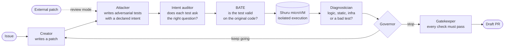

<div align="center">

# Vanta

**Autonomous adversarial verification for AI-generated code.**

*AI coding tools keep getting better at writing code. The hard part is proving the code doesn't break anything.*

[](#project-status)
[](https://www.rust-lang.org/)
[-lightgrey)](#requirements)
[](#reproducing-the-bugsinpy-evaluation)
[](LICENSE)
[](#citation)

</div>

---

## Why Vanta

Most AI coding pipelines decide a patch is good because the failing test now passes. That answers one narrow question, and it misses the one that matters in a real codebase: what else did the patch break, and does it actually do what the issue asked?

Vanta treats every patch, whether an agent, a human or another tool wrote it, as something to be attacked rather than trusted. An adversarial agent writes targeted tests against it, each test has to prove it is meaningful on the original code before it is allowed to judge the patch, everything runs inside a disposable microVM, and a governor decides when the evidence is strong enough to stop. The output is a verdict you can audit line by line, not a vibe.

## How it works



| Role | What it does |
|---|---|
| **Creator** | Reads the issue and the relevant code, and writes a patch (one or many files in a single attempt). |
| **Attacker** | Writes tests designed to break the patch. Every test declares its intent: reproduce the bug, preserve existing behaviour, or accept the requested feature. |
| **Intent auditor** | Checks that each test actually asks what the issue asks, so the patch is judged against the right specification. |
| **BATE** | Baseline-Aware Test Execution. Runs every generated test on the *unmodified* code first. A bug-reproduction test must fail there and a behaviour-preservation test must pass, otherwise the test is revised or discarded before it can judge anything. |
| **Diagnostician** | Classifies each failure as a logic error, a static error, an infrastructure problem or a defect in the test itself, so environment noise never masquerades as a verdict. |
| **Governor** | Decides whether another round is worth it, using a stability rule over how often patches break passing tests versus fix failing ones. |
| **Gatekeeper** | Opens a draft PR only when every required check has passed. |

## Two ways to use it

**Repair mode** gives Vanta an issue and lets the Creator and Attacker iterate until the Governor is satisfied.

**Review mode** gives Vanta someone else's patch. The Creator steps aside, and the Attacker, BATE and the native test suite decide whether the patch should be approved or rejected. This is the mode for checking code written by other AI agents.

## What makes a verdict trustworthy

Vanta is built as a research instrument, so the plumbing around a verdict gets as much care as the agents themselves.

- **Untrusted code only ever runs inside a microVM.** There is no fallback to running it on the host.
- **Hidden oracle tests never enter the agents' sandbox.** Ground-truth grading happens separately, so a verdict can't leak into the thing being measured.
- **A test has to earn the right to judge.** BATE throws out generated tests that are meaningless on the original code before they can reject anything.
- **Infrastructure failures are never scored as model outcomes.** A sandbox that fails to boot, a suite that collects zero tests, or a patch that only half-applies is recorded as an infrastructure failure, not as a pass or a reject.
- **Every result row is reproducible on paper.** Each row records its harness commit, model, sampling, prompt-template hashes, environment and a hash of the frozen configuration, and the analysis refuses to pool rows that ran under different configurations.
- **Repair and replay are measured, not eyeballed.** Every attempt's patch is stored and replayed against one shared test set, so the rate at which patches break passing tests can be counted directly.

## Requirements

- macOS on Apple silicon (the current sandbox is Shuru, built on Apple's Virtualization framework; a Linux backend is planned)
- Rust stable
- Python 3 for the evaluation harness
- An OpenAI-compatible model endpoint

## Quickstart

```bash
git clone https://github.com/Kyu-Yi/vanta.git
cd vanta
cargo build --release --bin vanta_m3

export VANTA_LLM_BACKEND=openai
export VANTA_LLM_MODEL="your-model-name"
export OPENAI_API_KEY="your-key-here"
```

Repair an issue in a target repository:

```bash
./target/release/vanta_m3 --repo ./target-repo --issue ./bug.md
```

Review an existing patch instead:

```bash
./target/release/vanta_m3 --repo ./target-repo --issue ./bug.md --patch ./candidate.patch
```

Add `--max-attempts N` to change how many repair attempts the Creator gets, `--json` for machine-readable output, and `--open-pr` to let the Gatekeeper open a draft pull request once every check has passed. Run `./target/release/vanta_m3 --help` for the full list of options.

## Reproducing the BugsInPy evaluation

The evaluation harness prepares each bug in its own pinned environment, runs every arm, and replays every stored attempt so the stability metrics can be computed.

```bash
SPLIT=plans/bugsinpy_split.json
BATCH=runs/bugsinpy/my-batch

python3 scripts/bugsinpy_run.py prepare --split $SPLIT --batch $BATCH
python3 scripts/bugsinpy_run.py run     --split $SPLIT --batch $BATCH
python3 scripts/bugsinpy_run.py replay  --batch $BATCH
python3 scripts/analyse.py --batches "$BATCH" --out paper/generated/
```

`prepare` builds each bug's environment once and measures its native test suite, `run` executes every configured arm under the frozen configuration in `configs/v1-m3.toml`, `replay` reconstructs each repair run attempt by attempt, and `analyse.py` writes every table and figure deterministically, so running it twice produces byte-identical files.

Every row ends up with one of these labels, graded against the benchmark's hidden tests and the project's own suite:

| Label | Meaning |
|---|---|
| `true_approval` | A correct patch was approved |
| `false_approval` | A bad patch was approved (the outcome Vanta exists to prevent) |
| `true_reject` | A bad patch was rejected |
| `false_reject` | A correct patch was rejected |
| `unresolved` | Repair ran out of attempts without a passing patch |
| `infra_failure` / `unobservable` | The environment, not the model, decided the outcome, so the row is excluded from model metrics |

The comparison arms include a single-attempt repair baseline, a linear multi-attempt repair baseline, adversarial tests without BATE, the project's native test suite on its own, and an LLM judge with and without the suite.

## Project status

| Component | Status |
|---|---|
| Creator, Attacker, intent auditor, BATE, Diagnostician, Governor, Gatekeeper | ✅ Working end to end |
| Shuru microVM sandbox (macOS) | ✅ Working |
| BugsInPy harness with baseline arms and an LLM-judge comparison | ✅ Working |
| Attempt replay and stability measurement | ✅ Working |
| Frozen, hashed run configuration | ✅ Working |
| Cost accounting and cache-friendly prompts | ✅ Working |
| Multi-bug job queue across parallel VMs | ✅ Working |
| Linux sandbox backend | 🔜 Planned |
| Broader benchmarks | 🔜 Planned |

## Roadmap

- [x] v0.2: research prototype with Creator, Attacker and BATE validation in a microVM sandbox
- [x] v0.3: BugsInPy evaluation harness with baseline arms, frozen configuration and replay-based measurement of test stability
- [ ] Next: reducing false rejections and helping the repair loop recover from wrong first attempts
- [ ] Later: evaluation on broader benchmarks and a Linux sandbox
- [ ] Paper: in preparation

## Known limitations

Vanta is a research prototype, and these are the failure modes it currently shows most clearly:

- **Localization on large repositories.** The Creator works from a selected slice of the codebase. On very large projects, the file that needs fixing can fall outside that slice, and the Creator then edits code it has not seen.
- **Fixation.** Across attempts, the Creator can keep returning to the same file even when the real cause is elsewhere.
- **Wrong-expectation tests.** An adversarial test that expects the wrong behaviour can reject a correct fix. BATE filters many of these, but not all.
- **macOS only for now.** The sandbox depends on Apple's Virtualization framework.

These are being measured deliberately, because they are exactly what the next version targets.

## Repository layout

```
src/agents/       Creator, Attacker and auditor agents
src/pipeline/     driver, BATE, Diagnostician, Governor, patch application
src/sandbox/      Shuru microVM backend
src/context/      context selection for large repositories
src/llm/          model backends, sampling and cost accounting
scripts/          BugsInPy harness, replay and analysis
configs/          frozen run configurations
tests/            integration tests
```

## Citation

If you use Vanta in your research, please cite it:

```bibtex
@software{lawson2026vanta,
  author = {Lawson, Nathan Owen},
  title  = {Vanta: Autonomous Adversarial Verification for AI-Generated Code},
  year   = {2026},
  url    = {https://github.com/Kyu-Yi/vanta}
}
```

The Governor's stopping rule builds on Liu and Meng ([arXiv:2604.22273](https://arxiv.org/abs/2604.22273)).

## License

MIT. See [LICENSE](LICENSE).

## Author

Built by Nathan Owen Lawson as part of an MSc in AI and Computer Science at KAIST.
